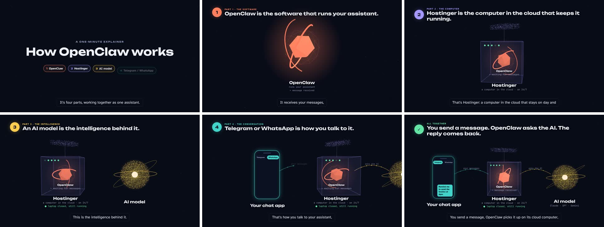

# Video Studio

**Ask Claude for a video. Get back a narrated, captioned MP4.**

> *"Check out example.com and create a marketing video for it."*
> *"I need a training video on how to add a member in our admin site."*
> *"Make a one-minute explainer of how our system works, from the docs folder."*

Video Studio is a [Claude Code](https://claude.com/claude-code) project. You open it in Claude Code, say
what you want, and Claude does the rest: it researches the subject, writes the script, records the
voice-over, animates the scenes, renders a 1080p MP4 and checks the result before it hands it back.


The example above is in this repo: the sources are in [`videos/openclaw/`](videos/openclaw/) and the finished
video is [`out/openclaw/openclaw-v2.mp4`](out/openclaw/openclaw-v2.mp4) (62 seconds, with captions
and a script). It was made from this four-line brief:

```text
OpenClaw is the software running your assistant.
Hostinger is the computer in the cloud that keeps it running.
An AI model is the intelligence behind it.
Telegram/Whatsapp is the way to communicate with it.
```



## What it makes

- **Marketing and product videos** from a website: Claude visits the pages, takes screenshots and
  reads the text, then tells the product's story using only what the site says.
- **Training videos and tutorials** for a real app: Claude clicks through the app in a read-only browser,
  takes screenshots of each step, then animates a cursor, zoom and highlight over each one in time with the narration.
- **Explainers** from a brief, a docs folder or a codebase.

Every video gets:

- natural narration from ElevenLabs
- captions burned into the picture, plus an `.srt` file
- a script as Markdown
- loudness-normalised audio (-16 LUFS)
- an automatic check of the finished file

## How it works

```text
your request
   │
   ▼
research ── website pages, docs, an app, files you attach      videos/<id>/research, capture
   │
   ▼
script ──── scenes with narration, headlines, sources noted     videos/<id>/video.json, NOTES.md
   │
   ▼
voice ───── one ElevenLabs clip per scene, with word timings    videos/<id>/audio, voice.json
   │
   ▼
scenes ──── React + Three.js in Remotion, synced to the words   videos/<id>/Video.tsx
   │
   ▼
storyboard ─ a still per scene to review before rendering        out/<id>/stills/contact.jpg
   │
   ▼
render + QA ─ MP4, captions, script; never overwrites           out/<id>/<id>-v<N>.mp4
```

The narration drives the timing. Each scene lasts as long as its voice clip, and animations are tied to
the moment a phrase is spoken, so a click lands on the word "click".

The instructions Claude follows are in [`.claude/skills/make-video/SKILL.md`](.claude/skills/make-video/SKILL.md).
Read that file to see exactly what it does or to change its rules.

## Get started

You need:

- [Claude Code](https://claude.com/claude-code)
- Node 24 and pnpm 10
- `ffmpeg` and `ffprobe` on your `PATH`
- an [ElevenLabs](https://elevenlabs.io) API key for the voice-over

No GPU is needed: 3D scenes render through SwiftShader.

```bash
git clone https://github.com/theunisdk/video-studio.git
cd video-studio
pnpm install
pnpm exec playwright install chromium     # only for website and app screenshots
export ELEVENLABS_API_KEY=...             # or keep it in a secrets manager; never commit it
```

Render the example to check your setup. It takes a few minutes and writes a new version next to the committed one, `out/openclaw/openclaw-v3.mp4`:

```bash
pnpm render openclaw
```

Then open Claude Code in the folder and ask for a video:

```bash
claude
> Check out example.com and create a 60-second marketing video for it.
```

Claude will tell you what it assumed, show you the storyboard if you ask to approve the look first, and
give you the path of the finished MP4.

## Your videos stay private

Videos often contain client material, so everything under `videos/` and `out/` is git-ignored except the
OpenClaw example. You can make videos in a clone of this public repo and nothing about them is ever
committed. Back those folders up yourself if you need to keep them.

When a video shows a real app, check the screenshots for personal data (names, phone numbers, email
addresses) before you share it. Use demo data, or blur it.

## Styles

| Style | Good for |
|---|---|
| Neon 3D, dark | software, systems and abstract ideas (the OpenClaw example) |
| Flat 2D, light | message flows, people and roles, phones and chats |
| Illustrated 3D, light | people in real places: homes, clinics, offices |
| Screenshot walkthrough | step-by-step use of a real app or website |

Claude picks one to suit the subject. You can also name one: *"…in the flat 2D style"*.

## Commands

You rarely need these, because Claude runs them. They are here for when you want to work by hand.

```bash
pnpm capture-site <id> <url> [<url> ...]   # screenshots + page text into videos/<id>/research/
pnpm voice <id>                            # make narration clips (cached: only changed lines cost credits)
pnpm voice <id> --placeholder              # silent clips, to build scenes before narration exists
pnpm render <id> --stills-only             # storyboard stills + out/<id>/stills/contact.jpg
pnpm render <id> --preview                 # render with placeholder narration
pnpm render <id>                           # out/<id>/<id>-v<N>.mp4 + .srt + .md
pnpm studio                                # live preview in the browser (Remotion Studio)
pnpm typecheck
```

Every render is a new version (`-v1`, `-v2`, …), so earlier renders are never lost.

## Layout

```text
.claude/skills/make-video/   the instructions Claude follows
videos/<id>/                 one folder per video (git-ignored except openclaw)
  video.json                   script: scenes, narration, headlines, voice
  voice.json                   generated: clip durations and word timings
  Video.tsx                    the scenes
  index.ts                     registers the video
  audio/                       narration clips
  research/, capture/          website and app screenshots
  NOTES.md                     sources and assumptions
out/<id>/                    renders (git-ignored except openclaw)
src/kit/                     reusable scene pieces: 3D objects, people, phones, captions, walkthroughs
src/video/                   video.json schema, audio-driven timeline, captions
scripts/                     voice, render, and the read-only capture browser
```

## Licence

The code in this repo is MIT licensed (see [`LICENSE`](LICENSE)).

It renders with [Remotion](https://www.remotion.dev), which has its own licence. Remotion is free for
individuals and for companies of up to three people. Larger companies need a Remotion company licence
(see <https://www.remotion.dev/docs/license>).

ElevenLabs voices are used under your own ElevenLabs plan. Check its terms for commercial use.
