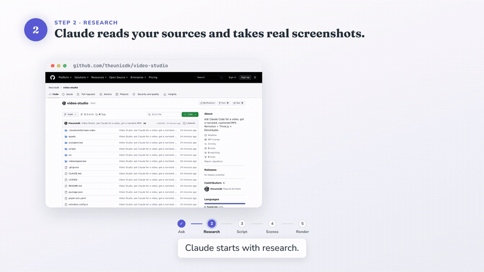
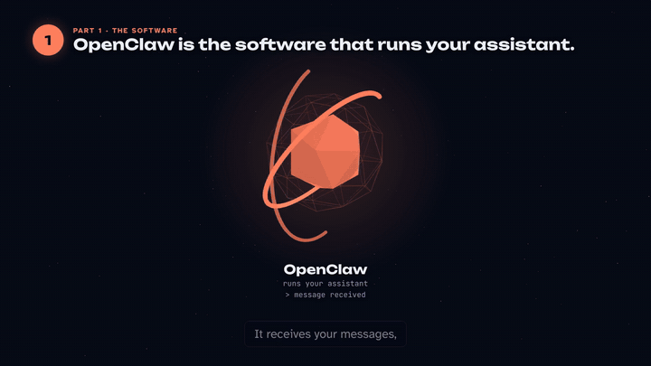

# Video Studio

**Ask Claude for a video. Get back a narrated, captioned MP4.**

> *"Check out example.com and create a marketing video for it."*
> *"I need a training video on how to add a member in our admin site."*
> *"Make a one-minute explainer of how our system works, from the docs folder."*

Video Studio is a [Claude Code](https://claude.com/claude-code) project. You open it in Claude Code, say
what you want, and Claude does the rest: it researches the subject, writes the script, records the
voice-over, animates the scenes, renders a 1080p MP4 and checks the result before it hands it back.

[](out/getting-started/getting-started-v2.mp4)

**Watch the 80-second tour, with sound:** [`out/getting-started/getting-started-v2.mp4`](out/getting-started/getting-started-v2.mp4).
Video Studio made it about itself: Claude took a screenshot of this repo's GitHub page, wrote the script,
recorded the voice-over and built the scenes. Its sources are in [`videos/getting-started/`](videos/getting-started/).

## What it makes

- **Marketing and product videos** from a website: Claude visits the pages, takes screenshots and
  reads the text, then tells the product's story using only what the site says.
- **Training videos and tutorials** for a real app: Claude clicks through the app in a read-only browser,
  takes screenshots of each step, then animates a cursor, zoom and highlight over each one in time with the narration.
- **Explainers** from a brief, a docs folder or a codebase.

Every video gets:

- natural narration from ElevenLabs
- captions burned into the picture, plus an `.srt` file
- a script as Markdown
- loudness-normalised audio (-16 LUFS)
- an automatic check of the finished file

## Examples

| Video | Look | Sources | Render |
|---|---|---|---|
| Getting started with Video Studio (80 s) | flat 2D with real screenshots | [`videos/getting-started/`](videos/getting-started/) | [`getting-started-v2.mp4`](out/getting-started/getting-started-v2.mp4) |
| How OpenClaw works (62 s) | neon 3D explainer | [`videos/openclaw/`](videos/openclaw/) | [`openclaw-v2.mp4`](out/openclaw/openclaw-v2.mp4) |

The OpenClaw explainer was made from this four-line brief:

```text
OpenClaw is the software running your assistant.
Hostinger is the computer in the cloud that keeps it running.
An AI model is the intelligence behind it.
Telegram/Whatsapp is the way to communicate with it.
```



## How it works

```text
your request
   │
   ▼
research ── website pages and brand, docs, an app, files       videos/<id>/research, capture
   │
   ▼
design ──── a look for this video: palette, type, titles,       videos/<id>/design.md, video.json
            captions, motion, transitions (or a saved series)
   │
   ▼
script ──── scenes with narration, headlines, sources noted     videos/<id>/video.json, NOTES.md
   │
   ▼
voice ───── one ElevenLabs clip per scene, with word timings    videos/<id>/audio, voice.json
   │
   ▼
scenes ──── React + Three.js in Remotion, synced to the words   videos/<id>/Video.tsx
   │
   ▼
storyboard ─ a still per scene, compared with recent videos      out/<id>/stills/contact.jpg, compare.jpg
   │
   ▼
render + QA ─ MP4, captions, script; never overwrites           out/<id>/<id>-v<N>.mp4
```

The narration drives the timing. Each scene lasts as long as its voice clip, and animations are tied to
the moment a phrase is spoken, so a click lands on the word "click".

The instructions Claude follows are in [`.claude/skills/make-video/SKILL.md`](.claude/skills/make-video/SKILL.md).
Read that file to see exactly what it does or to change its rules.

## Get started

You need:

- [Claude Code](https://claude.com/claude-code)
- Node 24 and pnpm 10
- `ffmpeg` and `ffprobe` on your `PATH`
- an [ElevenLabs](https://elevenlabs.io) API key for the voice-over

No GPU is needed: 3D scenes render through SwiftShader.

```bash
git clone https://github.com/theunisdk/video-studio.git
cd video-studio
pnpm install
pnpm exec playwright install chromium     # only for website and app screenshots
export ELEVENLABS_API_KEY=...             # or keep it in a secrets manager; never commit it
```

Render the OpenClaw example to check your setup. It takes a few minutes and writes a new version next to the committed one, `out/openclaw/openclaw-v3.mp4`:

```bash
pnpm render openclaw
```

Then open Claude Code in the folder and ask for a video:

```bash
claude
> Check out example.com and create a 60-second marketing video for it.
```

Claude will tell you what it assumed, show you the storyboard if you ask to approve the look first, and
give you the path of the finished MP4 with the look it chose and two alternatives.

## Your videos stay private

Videos often contain client material, so everything under `videos/`, `out/` and `series/` is git-ignored
except the two examples (`openclaw` and `getting-started`) and the demo series (`series/demo/`). You can make videos in a clone of this public repo and nothing about them is ever
committed. Back those folders up yourself if you need to keep them.

When a video shows a real app, check the screenshots for personal data (names, phone numbers, email
addresses) before you share it. Use demo data, or blur it.

## Every video gets its own look

Claude designs each video from its subject, audience, purpose, tone and brand. For a website it takes the
site's colours, fonts and logo from the capture (`research/brand.json` when the capture saved one, otherwise
the screenshots). It writes the direction down in `videos/<id>/design.md`
and the tokens in a `design` block in `video.json`, then builds the scenes from them: palette, fonts
(Google Fonts or your own font files), shapes, background, title and caption treatments, motion and
transitions.

It starts from a [library of looks](.claude/skills/make-video/looks/README.md), such as editorial,
blueprint, terminal, poster, Swiss, sketch, cinematic 3D, the neon 3D of the OpenClaw example and the flat
2D of the getting-started tour, and adapts, mixes or departs from them. Before rendering, `pnpm compare`
puts the storyboard next to the last few videos so a new video doesn't come out looking like the previous one.

Claude doesn't ask you to choose. When it hands the video back it names the look it used and two others
that would fit. Say *"make it blueprint instead"* and you get a new version in that look. The earlier
version stays, and so do the sources that made it.

To see every title, caption, transition, motion and background variant the kit can draw, run
`pnpm gallery` (stills in `out/kit-gallery/`), or open `kit-gallery` in `pnpm studio`.

## Series: one look for a set of videos

For a run of training videos, save a look as a series and reuse it:

> *"Save this look as the onboarding series."*
> *"Make the next video in the onboarding series, on resetting a password."*

A series is a folder, `series/<name>/`, holding the tokens (`design.json`), the direction with its
continuity rules (`design.md`), the voice (`series.json`), any series parts such as an intro card
(`components/`) and the brand files (`assets/`). Each new episode copies the series into its own video
folder, so it keeps rendering the same way even if the series changes later. Series carry brands, so
`series/` is git-ignored like `videos/`. You can copy a series folder to another machine.

`series/demo/` is the one public example: a made-up training school, Lanternfield Academy. Try it:

```bash
claude
> Make a short training video in the demo series on how to ask Video Studio for a video.
```

## Commands

You rarely need these, because Claude runs them. They are here for when you want to work by hand.

```bash
pnpm capture-site <id> <url> [<url> ...]   # screenshots + page text into videos/<id>/research/
pnpm voice <id>                            # make narration clips (cached: only changed lines cost credits)
pnpm voice <id> --placeholder              # silent clips, to build scenes before narration exists
pnpm render <id> --stills-only             # storyboard stills + out/<id>/stills/contact.jpg
pnpm render <id> --preview                 # render with placeholder narration
pnpm render <id>                           # out/<id>/<id>-v<N>.mp4 + .srt + .md, sources kept in videos/<id>/versions/
pnpm compare <id>                          # storyboard beside recent videos: out/<id>/stills/compare.jpg
pnpm series:export <id> <name>             # save a video's look as series/<name>/
pnpm series:use <name> <id>                # start a video in a series (copies its look into videos/<id>/)
pnpm restore <id> v2                       # put an earlier version's sources back, to render that look again
pnpm gallery                               # stills of every kit treatment: out/kit-gallery/
pnpm studio                                # live preview in the browser (Remotion Studio)
pnpm typecheck
```

Every render is a new version (`-v1`, `-v2`, …), so earlier renders are never lost.

## Layout

```text
.claude/skills/make-video/   the instructions Claude follows
.claude/skills/make-video/looks/  the looks library Claude designs from
videos/<id>/                 one folder per video (git-ignored except the two examples)
  video.json                   script: scenes, narration, headlines, voice, design tokens
  design.md                    the look and why it fits
  voice.json                   generated: clip durations and word timings
  Video.tsx                    the scenes
  index.ts                     registers the video
  audio/                       narration clips
  research/, capture/          website and app screenshots
  NOTES.md                     sources and assumptions
  versions/                    the sources behind each render
series/<name>/               saved looks shared by several videos (git-ignored except series/demo/)
out/<id>/                    renders (git-ignored except the two examples)
src/kit/                     reusable scene pieces: design tokens, titles, captions, transitions, motion,
                             3D objects, people, phones, walkthroughs
src/video/                   video.json schema, audio-driven timeline, captions
scripts/                     voice, render, compare, series, and the read-only capture browser
```

## Licence

The code in this repo is MIT licensed (see [`LICENSE`](LICENSE)).

It renders with [Remotion](https://www.remotion.dev), which has its own licence. Remotion is free for
individuals and for companies of up to three people. Larger companies need a Remotion company licence
(see <https://www.remotion.dev/docs/license>).

ElevenLabs voices are used under your own ElevenLabs plan. Check its terms for commercial use.
